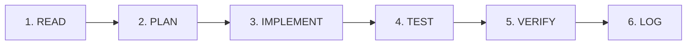

# HƯỚNG DẪN HOẠT ĐỘNG DÀNH CHO AI AGENT (AGENTS.MD)

> **Phạm vi áp dụng:** Áp dụng bắt buộc cho mọi phiên làm việc của AI Agent (Antigravity, Cursor, Copilot, Gemini, Claude, GPT, v.v.) trong repository **DIEM_DANH (LH-NaviX)**.

---

## 1. NGUYÊN TẮC CỐT LÕI (CORE PRINCIPLES)

1. **Hiểu rõ trước khi hành động (Read Before Act):**
   - Tuyệt đối không giả định hay đoán mò về cấu trúc code, schema database, hay luồng dữ liệu.
   - Luôn đọc các tài liệu tiến độ và mã nguồn thực tế trước khi bắt tay vào sửa đổi.

2. **Tôn trọng kiến trúc hiện hữu (Respect Existing Architecture):**
   - **Frontend:** Vanilla JS, CSS thuần, HTML5 (SPA). Không tự ý cài đặt thêm các thư viện giao diện nặng (React, Vue, Tailwind, v.v.) trừ khi có yêu cầu rõ ràng.
   - **Backend / Database:** Supabase (PostgreSQL 17), RLS (Row Level Security), Stored Procedures / RPC, Realtime, Storage. Mọi thay đổi dữ liệu phải tương thích với schema và bảo mật RLS.
   - **IoT / Hardware:** ESP32 Kiosk (`esp32_kiosk/`) và ESP32 Cam (`esp32_cam_ai/`). Lưu ý các endpoint URL, token, và cơ chế xoay QR động.

3. **Tối giản & Đúng trọng tâm (Ponytail Mindset - YAGNI):**
   - Xóa trước khi thêm; tận dụng những gì stdlib và codebase đã có sẵn.
   - Sửa tận gốc nguyên nhân lỗi (root cause), không sửa kiểu chắp vá triệu chứng.

---

## 2. QUY TRÌNH LÀM VIỆC 6 BƯỚC (6-STEP WORKFLOW)

Mọi phiên làm việc khi nhận nhiệm vụ từ người dùng **BẮT BUỘC** phải tuân thủ nghiêm ngặt chu trình:

### Bước 1: READ (Đọc & Đối chiếu hiện trạng)
- Mở và đọc 3 file quản lý trong thư mục `docs/`:
  1. [`docs/AI_PROGRESS.md`](file:///c:/Users/ACER/Documents/GitHub/DIEM_DANH/docs/AI_PROGRESS.md): Nắm nhiệm vụ đang chạy, task dang dở, hoặc blocker.
  2. [`docs/AI_PLAN.md`](file:///c:/Users/ACER/Documents/GitHub/DIEM_DANH/docs/AI_PLAN.md): Xem phạm vi và tiêu chí nghiệm thu của task.
  3. [`docs/AI_TEST_LOG.md`](file:///c:/Users/ACER/Documents/GitHub/DIEM_DANH/docs/AI_TEST_LOG.md): Nắm lịch sử test gần nhất và các lỗi đã phát hiện.
- **Đối chiếu mã nguồn:** Mở các file mã nguồn liên quan trực tiếp đến task để xác minh xem code thực tế có khớp với mô tả trong doc hay không.

### Bước 2: PLAN (Lập kế hoạch & Cập nhật phạm vi)
- Xác định rõ:
  - Mục tiêu cụ thể cần đạt.
  - Danh sách file cần sửa/tạo mới.
  - Các rủi ro tiềm ẩn (break tính năng cũ, xung đột RLS, lỗi kết nối thiết bị).
  - Tiêu chí nghiệm thu (Acceptance Criteria / Definition of Done).
- Cập nhật thông tin task vào [`docs/AI_PLAN.md`](file:///c:/Users/ACER/Documents/GitHub/DIEM_DANH/docs/AI_PLAN.md) và cập nhật trạng thái `[IN_PROGRESS]` trong [`docs/AI_PROGRESS.md`](file:///c:/Users/ACER/Documents/GitHub/DIEM_DANH/docs/AI_PROGRESS.md).

### Bước 3: IMPLEMENT (Triển khai mã nguồn)
- Thực hiện chỉnh sửa mã nguồn với diff tối thiểu, rõ ràng, sạch sẽ.
- Giữ nguyên các comment giải thích nghiệp vụ, không xóa mã đang chạy tốt mà không có lý do.
- Đảm bảo kiểm tra validation đầu vào, xử lý ngoại lệ và an toàn dữ liệu.

### Bước 4: TEST (Thực thi kiểm thử thực tế)
- Chạy kiểm tra thực tế:
  - Kiểm tra cú pháp, runtime bằng script (Node.js/Python), terminal command, hoặc test harness.
  - Đối với giao diện web/browser: kiểm tra lỗi console, tính khả dụng của DOM, luồng tương tác.
  - Đối với database: chạy câu lệnh query hoặc script kiểm tra RPC/RLS (nếu có môi trường dev).
- **Tuyệt đối không kiểm thử bằng suy nghĩ giả lập:** Phải có lệnh chạy hoặc hành động tương tác thật.

### Bước 5: VERIFY (Xác minh bằng chứng)
- So sánh kết quả test thực tế với Tiêu chí nghiệm thu đã cam kết ở bước PLAN.
- Phân định rõ 3 mức độ nhận thức:
  - **KNOWN:** Điều đã được chứng minh qua output lệnh test thật.
  - **LIKELY:** Khả năng cao nhưng chưa thể test trực tiếp (ví dụ cần thiết bị phần cứng ESP32 thực tế).
  - **UNKNOWN:** Vấn đề còn nghi vấn hoặc thiếu dữ kiện, cần hỏi người dùng.

### Bước 6: LOG (Ghi nhận nhật ký & Cập nhật tiến độ)
- Ghi lại bằng chứng kiểm thử (lệnh chạy, kết quả stdout/stderr, mã lỗi nếu có) vào [`docs/AI_TEST_LOG.md`](file:///c:/Users/ACER/Documents/GitHub/DIEM_DANH/docs/AI_TEST_LOG.md).
- Chỉ sau khi bước TEST và VERIFY đạt (PASS), mới cập nhật trạng thái `[DONE]` trong [`docs/AI_PROGRESS.md`](file:///c:/Users/ACER/Documents/GitHub/DIEM_DANH/docs/AI_PROGRESS.md) kèm mã tham chiếu đến Test Log tương ứng.

---

## 3. BA NGUYÊN TẮC KỶ LUẬT TUYỆT ĐỐI (NON-NEGOTIABLE RULES)

Mọi vi phạm 3 quy tắc sau đây đều bị coi là lỗi nghiêm trọng của AI Agent:

### 🚫 Điều 1: KHÔNG TỰ ĐÁNH DẤU HOÀN THÀNH KHI CHƯA CÓ BẰNG CHỨNG
- Cấm tự ý đổi trạng thái sang `[DONE]` nếu chưa có nhật ký kiểm thử thành công ghi nhận tại `AI_TEST_LOG.md`.
- Nếu chưa test được do thiếu phần cứng hoặc thiếu tài khoản xác thực, trạng thái cao nhất chỉ được phép là `[VERIFYING]` hoặc `[BLOCKED]`, kèm ghi chú rõ lý do cần người dùng hỗ trợ kiểm chứng.

### 🚫 Điều 2: KHÔNG BỎ QUA YÊU CẦU KHÓ HOẶC TỰ Ý GIẢM PHẠM VI (SCOPE REDUCTION)
- Khi gặp bài toán phức tạp (nhận diện khuôn mặt, RLS phân quyền đa cấp, đồng bộ thời gian thực Kiosk), AI **KHÔNG ĐƯỢC PHÉP**:
  - Tự ý bỏ bớt tính năng mà người dùng đã chỉ định.
  - Thay đổi bài toán sang một hướng dễ hơn mà không có sự đồng ý của người dùng.
- Nếu giải pháp gặp rào cản kỹ thuật, phải trình bày rõ nguyên nhân gốc rễ (root cause), đề xuất 1-2 phương án khả thi kèm đánh đổi (trade-offs) để cùng người dùng quyết định.

### 🚫 Điều 3: KHÔNG TỰ TẠO HOẶC LÀM GIẢ KẾT QUẢ KIỂM THỬ (NO FABRICATED TEST RESULTS)
- Nghiêm cấm bịa đặt logs, giả lập output test giả vờ là đã chạy thành công.
- Lệnh chạy ra lỗi gì phải ghi trung thực lỗi đó vào `AI_TEST_LOG.md`. Thất bại trong kiểm thử là thông tin quý giá để sửa đúng trọng tâm.

### 🚫 Điều 4: TUYỆT ĐỐI KHÔNG SỬA ĐỔI TÍNH NĂNG ĐÃ ĐÓNG BĂNG (FROZEN CODE IS SACRED)
- Khi một tính năng đã được người dùng kiểm chứng chạy tốt và ghi nhận trong [`docs/FROZEN_FEATURES.md`](file:///c:/Users/ACER/Documents/GitHub/DIEM_DANH/docs/FROZEN_FEATURES.md), AI **NGHIÊM CẤM TỰ Ý SỬA ĐỔI, TỐI ƯU HÓA HOẶC THAY THẾ**.
- Mọi can thiệp vào các tham số nhạy cảm (như timing, delay polling, định dạng chuỗi, cấu trúc socket) mà không có yêu cầu cụ thể từ người dùng đều bị coi là phá hỏng tính năng (regression).

---

## 4. TÀI LIỆU QUẢN TRỊ TRONG HỆ THỐNG

| File | Đường dẫn | Mục đích sử dụng |
|---|---|---|
| **AGENTS.md** | [`AGENTS.md`](file:///c:/Users/ACER/Documents/GitHub/DIEM_DANH/AGENTS.md) | Hiến chương & quy chuẩn hoạt động bắt buộc cho mọi Agent. |
| **FROZEN_FEATURES.md** | [`docs/FROZEN_FEATURES.md`](file:///c:/Users/ACER/Documents/GitHub/DIEM_DANH/docs/FROZEN_FEATURES.md) | Bảng danh mục các tính năng đã kiểm chứng chạy tốt, đóng băng cấm sửa đổi. |
| **AI_PLAN.md** | [`docs/AI_PLAN.md`](file:///c:/Users/ACER/Documents/GitHub/DIEM_DANH/docs/AI_PLAN.md) | Phân tích yêu cầu, danh sách task, tiêu chí nghiệm thu và thiết kế chi tiết. |
| **AI_PROGRESS.md** | [`docs/AI_PROGRESS.md`](file:///c:/Users/ACER/Documents/GitHub/DIEM_DANH/docs/AI_PROGRESS.md) | Bảng theo dõi tiến độ tổng thể, trạng thái công việc và lịch sử các phiên làm việc. |
| **AI_TEST_LOG.md** | [`docs/AI_TEST_LOG.md`](file:///c:/Users/ACER/Documents/GitHub/DIEM_DANH/docs/AI_TEST_LOG.md) | Nhật ký chạy test thực tế, lưu trữ output, lỗi phát sinh và bằng chứng nghiệm thu. |

---

## 5. CHECKLIST KHỞI ĐỘNG PHIÊN LÀM VIỆC MỚI (QUICK START FOR NEW SESSION)

Trước khi gửi tin nhắn đầu tiên hoặc gõ dòng code đầu tiên, hãy tự kiểm tra:
1. [ ] Đã đọc `docs/AI_PROGRESS.md` để biết phiên trước dừng ở đâu?
2. [ ] Đã đối chiếu trạng thái ghi trong file với mã nguồn thực tế chưa?
3. [ ] Đã hiểu đúng mục tiêu cốt lõi của người dùng mà không bị ảo giác phạm vi chưa?
4. [ ] Đã chuẩn bị phương án kiểm chứng chạy được trước khi code chưa?
