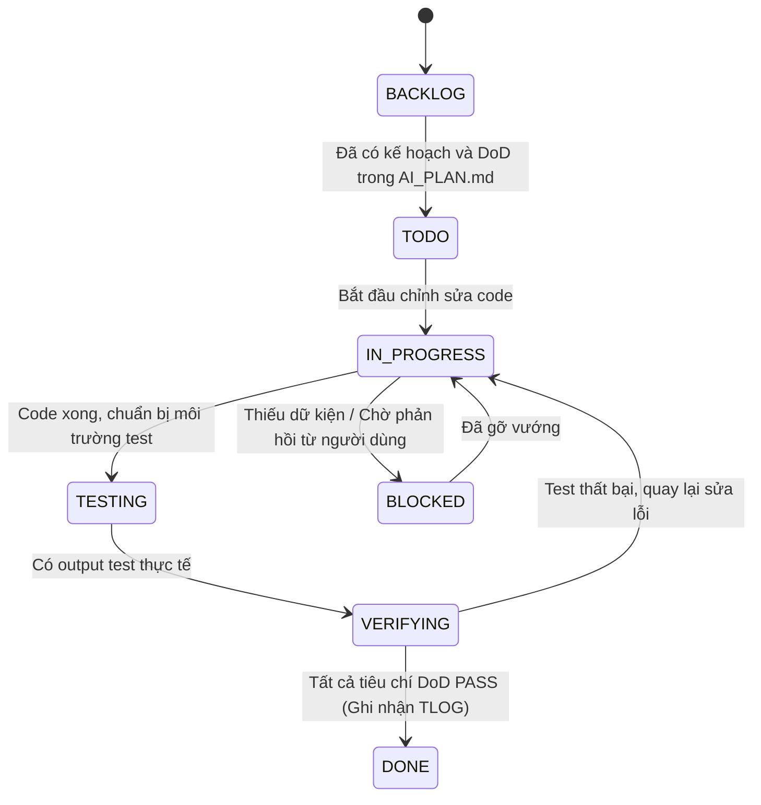

# TIẾN ĐỘ THỰC HIỆN CÔNG VIỆC AI (AI_PROGRESS.MD)

> **Mục đích:** Bảng điều phối trạng thái công việc tập trung. Mọi AI Agent khi bắt đầu phiên làm việc phải đọc file này đầu tiên để nắm bắt tiến độ và không bị trùng lặp công việc.

---

## 1. QUY TẮC CHUYỂN TRẠNG THÁI (STATE TRANSITION RULES)

> ⚠️ **ĐIỀU KIỆN TIÊN QUYẾT ĐỂ CHUYỂN SANG `[DONE]`:**
> Bắt buộc phải có mã tham chiếu kiểm thử dạng `TLOG-xxx` liên kết trực tiếp tới bản ghi kiểm thử thành công trong [`docs/AI_TEST_LOG.md`](file:///c:/Users/ACER/Documents/GitHub/DIEM_DANH/docs/AI_TEST_LOG.md). Nếu chưa có bằng chứng thực nghiệm, trạng thái chỉ được phép dừng ở `[VERIFYING]`.

---

## 2. BẢNG TRẠNG THÁI NHIỆM VỤ (TASK BOARD)

| Mã Task | Tên Nhiệm Vụ | Trạng Thái | Mức Độ | Bằng Chứng Kiểm Thử | Ngày Cập Nhật |
|---|---|---|---|---|---|
| [TASK-001](file:///c:/Users/ACER/Documents/GitHub/DIEM_DANH/docs/AI_PLAN.md#task-001-thiết-lập-hệ-sinh-thái-quản-lý-công-việc-ai-cho-workspace) | Thiết lập hệ sinh thái quản lý công việc AI cho workspace | `[DONE]` | High | [TLOG-001](file:///c:/Users/ACER/Documents/GitHub/DIEM_DANH/docs/AI_TEST_LOG.md#tlog-001-kiểm-định-tính-toàn-vẹn-của-hệ-thống-quản-lý-công-việc-ai-task-001) (PASS) | 2026-10-24 |
| [TASK-002](file:///c:/Users/ACER/Documents/GitHub/DIEM_DANH/docs/AI_PLAN.md#task-002-rà-soát-và-đồng-bộ-checklist-đổi-tên-github-123001058---lh-navix) | Rà soát và đồng bộ checklist đổi tên GitHub | `[TODO]` | Medium | Chưa thực hiện | 2026-10-24 |
| [TASK-003](file:///c:/Users/ACER/Documents/GitHub/DIEM_DANH/docs/AI_PLAN.md#task-003-rà-soát-bảo-mật-supabase-rls--tính-toàn-vẹn-của-stored-procedures) | Rà soát bảo mật Supabase RLS & Stored Procedures | `[BACKLOG]` | Low | Chưa thực hiện | 2026-10-24 |
| [TASK-004](file:///c:/Users/ACER/Documents/GitHub/DIEM_DANH/docs/AI_PLAN.md#task-004-xóa-bỏ-dead-code-orphan-components-và-biến-không-dùng-trên-toàn-bộ-frontend) | Xóa bỏ Dead Code, Orphan Components và Biến không dùng trên toàn bộ Frontend | `[DONE]` | High | [TLOG-002](file:///c:/Users/ACER/Documents/GitHub/DIEM_DANH/docs/AI_TEST_LOG.md#tlog-002-kiểm-thử-cú-pháp-và-tham-chiếu-sau-khi-xóa-dead-code--orphan-components-task-004) (PASS) | 2026-10-25 |
| [TASK-005](file:///c:/Users/ACER/Documents/GitHub/DIEM_DANH/docs/AI_PLAN.md#task-005-cập-nhật-địa-chỉ-ip-camera-esp32-sang-1921682168-và-chuẩn-hóa-kết-nối-luồng-stream) | Cập nhật địa chỉ IP Camera ESP32 sang 192.168.2.168 và chuẩn hóa kết nối luồng stream | `[DONE]` | High | [TLOG-003](file:///c:/Users/ACER/Documents/GitHub/DIEM_DANH/docs/AI_TEST_LOG.md#tlog-003-kiểm-thử-cập-nhật-ip-camera-esp32-1921682168--chuẩn-hóa-chuỗi-stream-task-005) (PASS) | 2026-10-27 |
| [TASK-006](file:///c:/Users/ACER/Documents/GitHub/DIEM_DANH/docs/AI_PLAN.md#task-006-cập-nhật-ip-camera-sang-1921682169-và-khắc-phục-triệt-để-lỗi-còi-buzzer-kêu-liên-tục) | Cập nhật IP Camera sang 192.168.2.169 & sửa logic Buzzer Active HIGH | `[DONE]` | Critical | [TLOG-004](file:///c:/Users/ACER/Documents/GitHub/DIEM_DANH/docs/AI_TEST_LOG.md#tlog-004-kiểm-thử-ip-mới-1921682169-stream-capture-và-sửa-logic-buzzer-task-006) (PASS) | 2026-10-27 |
| [TASK-007](file:///c:/Users/ACER/Documents/GitHub/DIEM_DANH/docs/AI_PLAN.md#task-007-chống-phát-âm-thanh-liên-tục-global-debounce-và-bổ-sung-nút-bậttắt-âm-thanh-loa--còi) | Chống phát âm thanh liên tục & bổ sung nút Bật/Tắt âm thanh Loa/Còi | `[DONE]` | High | [TLOG-005](file:///c:/Users/ACER/Documents/GitHub/DIEM_DANH/docs/AI_TEST_LOG.md#tlog-005-kiểm-thử-cơ-chế-chống-phát-âm-thanh-liên-tục-và-nút-toggle-mute-task-007) (PASS) | 2026-10-27 |
| [TASK-008](file:///c:/Users/ACER/Documents/GitHub/DIEM_DANH/docs/AI_PLAN.md#task-008-khắc-phục-triệt-để-lỗi-còi-buzzer-chân-g14-gpio-14-kêu-liên-tục-bằng-chuẩn-hóa-active-level) | Khắc phục triệt để lỗi còi chân G14 kêu liên tục bằng chuẩn hóa Active Level | `[DONE]` | Critical | [TLOG-006](file:///c:/Users/ACER/Documents/GitHub/DIEM_DANH/docs/AI_TEST_LOG.md#tlog-006-kiểm-thử-chuẩn-hóa-mức-kích-còi-active-low--active-high-chân-g14-task-008) (PASS) | 2026-10-27 |
| [TASK-009](file:///c:/Users/ACER/Documents/GitHub/DIEM_DANH/docs/AI_PLAN.md#task-009-khắc-phục-vuốtcuộn-danh-sách-lịch-sử-quét-trên-màn-hình-cảm-ứng) | Khắc phục vuốt/cuộn danh sách lịch sử quét trên màn hình cảm ứng | `[IN_PROGRESS]` | High | Chưa kiểm thử | 2026-10-27 |
| [TASK-010](file:///c:/Users/ACER/Documents/GitHub/DIEM_DANH/docs/AI_PLAN.md#task-010-khắc-phục-triệt-để-lỗi-không-reset-được-mật-khẩu-sinh-viên-edge-function-admin-reset-password) | Khắc phục triệt để lỗi không reset được mật khẩu sinh viên (Edge Function) | `[DONE]` | Critical | [TLOG-007](file:///c:/Users/ACER/Documents/GitHub/DIEM_DANH/docs/AI_TEST_LOG.md#tlog-007-kiểm-thử-khắc-phục-lỗi-không-reset-được-mật-khẩu-sinh-viên-task-010) (PASS) | 2026-10-27 |
| [TASK-011](file:///c:/Users/ACER/Documents/GitHub/DIEM_DANH/docs/AI_PLAN.md#task-011-hiển-thị-tên-sinh-viên-vừa-quét-qr-trên-lcd-esp32-kiosk) | Hiển thị tên sinh viên sau khi quét QR & Face AI trên LCD Kiosk | `[DONE]` | High | [TLOG-009](file:///c:/Users/ACER/Documents/GitHub/DIEM_DANH/docs/AI_TEST_LOG.md#tlog-009-kiểm-thử-tối-ưu-độ-trễ-hiển-thị-và-sửa-lỗi-quét-mặt-không-hiện-tên-trên-esp32-kiosk-task-011) (PASS) | 2026-10-27 |

---

## 3. NHẬT KÝ CÁC PHIÊN LÀM VIỆC (SESSION ACTIVITY LOGS)

### Phiên làm việc: 2026-10-24 (Khởi tạo hệ thống quản lý AI)
- **Agent/Model:** Antigravity / Thinking Partner (Gemini 3.8 Flash High)
- **Nhiệm vụ:** [TASK-001]
- **Tóm tắt hành động:**
  - Kiểm tra các quy tắc người dùng hiện có (`user_global`, `always-use-ponytail`) để đảm bảo không xung đột.
  - Khởi tạo [`AGENTS.md`](file:///c:/Users/ACER/Documents/GitHub/DIEM_DANH/AGENTS.md) tại thư mục gốc với quy trình 6 bước và 3 điều cấm nghiêm ngặt.
  - Khởi tạo [`docs/AI_PLAN.md`](file:///c:/Users/ACER/Documents/GitHub/DIEM_DANH/docs/AI_PLAN.md) cấu trúc nhiệm vụ chuẩn và danh sách task hiện hành.
  - Khởi tạo [`docs/AI_PROGRESS.md`](file:///c:/Users/ACER/Documents/GitHub/DIEM_DANH/docs/AI_PROGRESS.md) quản lý vòng đời và bảng trạng thái.
  - Khởi tạo [`docs/AI_TEST_LOG.md`](file:///c:/Users/ACER/Documents/GitHub/DIEM_DANH/docs/AI_TEST_LOG.md) ghi nhận log kiểm thử thực nghiệm.
