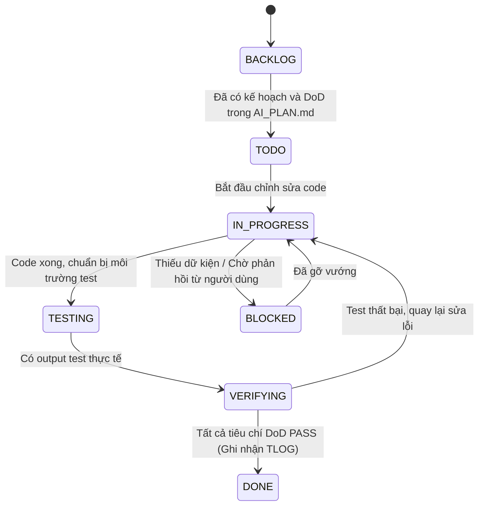

# TIẾN ĐỘ THỰC HIỆN CÔNG VIỆC AI (AI_PROGRESS.MD)

> **Mục đích:** Bảng điều phối trạng thái công việc tập trung. Mọi AI Agent khi bắt đầu phiên làm việc phải đọc file này đầu tiên để nắm bắt tiến độ và không bị trùng lặp công việc.

---

## 1. QUY TẮC CHUYỂN TRẠNG THÁI (STATE TRANSITION RULES)

> ⚠️ **ĐIỀU KIỆN TIÊN QUYẾT ĐỂ CHUYỂN SANG `[DONE]`:**
> Bắt buộc phải có mã tham chiếu kiểm thử dạng `TLOG-xxx` liên kết trực tiếp tới bản ghi kiểm thử thành công trong [`docs/AI_TEST_LOG.md`](file:///c:/Users/ACER/Documents/GitHub/DIEM_DANH/docs/AI_TEST_LOG.md). Nếu chưa có bằng chứng thực nghiệm, trạng thái chỉ được phép dừng ở `[VERIFYING]`.

---

## 2. BẢNG TRẠNG THÁI NHIỆM VỤ (TASK BOARD)

| Mã Task | Tên Nhiệm Vụ | Trạng Thái | Mức Độ | Bằng Chứng Kiểm Thử | Ngày Cập Nhật |
|---|---|---|---|---|---|
| [TASK-001](file:///c:/Users/ACER/Documents/GitHub/DIEM_DANH/docs/AI_PLAN.md#task-001-thiết-lập-hệ-sinh-thái-quản-lý-công-việc-ai-cho-workspace) | Thiết lập hệ sinh thái quản lý công việc AI cho workspace | `[DONE]` | High | [TLOG-001](file:///c:/Users/ACER/Documents/GitHub/DIEM_DANH/docs/AI_TEST_LOG.md#tlog-001-kiểm-định-tính-toàn-vẹn-của-hệ-thống-quản-lý-công-việc-ai-task-001) (PASS) | 2026-10-24 |
| [TASK-002](file:///c:/Users/ACER/Documents/GitHub/DIEM_DANH/docs/AI_PLAN.md#task-002-rà-soát-và-đồng-bộ-checklist-đổi-tên-github-123001058---lh-navix) | Rà soát và đồng bộ checklist đổi tên GitHub | `[TODO]` | Medium | Chưa thực hiện | 2026-10-24 |
| [TASK-003](file:///c:/Users/ACER/Documents/GitHub/DIEM_DANH/docs/AI_PLAN.md#task-003-rà-soát-bảo-mật-supabase-rls--tính-toàn-vẹn-của-stored-procedures) | Rà soát bảo mật Supabase RLS & Stored Procedures | `[BACKLOG]` | Low | Chưa thực hiện | 2026-10-24 |
| [TASK-004](file:///c:/Users/ACER/Documents/GitHub/DIEM_DANH/docs/AI_PLAN.md#task-004-xóa-bỏ-dead-code-orphan-components-và-biến-không-dùng-trên-toàn-bộ-frontend) | Xóa bỏ Dead Code, Orphan Components và Biến không dùng trên toàn bộ Frontend | `[DONE]` | High | [TLOG-002](file:///c:/Users/ACER/Documents/GitHub/DIEM_DANH/docs/AI_TEST_LOG.md#tlog-002-kiểm-thử-cú-pháp-và-tham-chiếu-sau-khi-xóa-dead-code--orphan-components-task-004) (PASS) | 2026-10-25 |
| [TASK-005](file:///c:/Users/ACER/Documents/GitHub/DIEM_DANH/docs/AI_PLAN.md#task-005-cập-nhật-địa-chỉ-ip-camera-esp32-sang-1921682168-và-chuẩn-hóa-kết-nối-luồng-stream) | Cập nhật địa chỉ IP Camera ESP32 sang 192.168.2.168 và chuẩn hóa kết nối luồng stream | `[DONE]` | High | [TLOG-003](file:///c:/Users/ACER/Documents/GitHub/DIEM_DANH/docs/AI_TEST_LOG.md#tlog-003-kiểm-thử-cập-nhật-ip-camera-esp32-1921682168--chuẩn-hóa-chuỗi-stream-task-005) (PASS) | 2026-10-27 |
| [TASK-006](file:///c:/Users/ACER/Documents/GitHub/DIEM_DANH/docs/AI_PLAN.md#task-006-cập-nhật-ip-camera-sang-1921682169-và-khắc-phục-triệt-để-lỗi-còi-buzzer-kêu-liên-tục) | Cập nhật IP Camera sang 192.168.2.169 & sửa logic Buzzer Active HIGH | `[DONE]` | Critical | [TLOG-004](file:///c:/Users/ACER/Documents/GitHub/DIEM_DANH/docs/AI_TEST_LOG.md#tlog-004-kiểm-thử-ip-mới-1921682169-stream-capture-và-sửa-logic-buzzer-task-006) (PASS) | 2026-10-27 |
| [TASK-007](file:///c:/Users/ACER/Documents/GitHub/DIEM_DANH/docs/AI_PLAN.md#task-007-chống-phát-âm-thanh-liên-tục-global-debounce-và-bổ-sung-nút-bậttắt-âm-thanh-loa--còi) | Chống phát âm thanh liên tục & bổ sung nút Bật/Tắt âm thanh Loa/Còi | `[DONE]` | High | [TLOG-005](file:///c:/Users/ACER/Documents/GitHub/DIEM_DANH/docs/AI_TEST_LOG.md#tlog-005-kiểm-thử-cơ-chế-chống-phát-âm-thanh-liên-tục-và-nút-toggle-mute-task-007) (PASS) | 2026-10-27 |
| [TASK-008](file:///c:/Users/ACER/Documents/GitHub/DIEM_DANH/docs/AI_PLAN.md#task-008-khắc-phục-triệt-để-lỗi-còi-buzzer-chân-g14-gpio-14-kêu-liên-tục-bằng-chuẩn-hóa-active-level) | Khắc phục triệt để lỗi còi chân G14 kêu liên tục bằng chuẩn hóa Active Level | `[DONE]` | Critical | [TLOG-006](file:///c:/Users/ACER/Documents/GitHub/DIEM_DANH/docs/AI_TEST_LOG.md#tlog-006-kiểm-thử-chuẩn-hóa-mức-kích-còi-active-low--active-high-chân-g14-task-008) (PASS) | 2026-10-27 |
| [TASK-009](file:///c:/Users/ACER/Documents/GitHub/DIEM_DANH/docs/AI_PLAN.md#task-009-khắc-phục-vuốtcuộn-danh-sách-lịch-sử-quét-trên-màn-hình-cảm-ứng) | Khắc phục vuốt/cuộn danh sách lịch sử quét trên màn hình cảm ứng | `[DONE]` | High | [TLOG-014](file:///c:/Users/ACER/Documents/GitHub/DIEM_DANH/docs/AI_TEST_LOG.md#tlog-014-khắc-phục-vuốtcuộn-danh-sách-lịch-sử-quét-phân-nhóm-ngày-trong-face-cam-task-009) (PASS) | 2026-10-28 |
| [TASK-010](file:///c:/Users/ACER/Documents/GitHub/DIEM_DANH/docs/AI_PLAN.md#task-010-khắc-phục-triệt-để-lỗi-không-reset-được-mật-khẩu-sinh-viên-edge-function-admin-reset-password) | Khắc phục triệt để lỗi không reset được mật khẩu sinh viên (Edge Function) | `[DONE]` | Critical | [TLOG-007](file:///c:/Users/ACER/Documents/GitHub/DIEM_DANH/docs/AI_TEST_LOG.md#tlog-007-kiểm-thử-khắc-phục-lỗi-không-reset-được-mật-khẩu-sinh-viên-task-010) (PASS) | 2026-10-27 |
| [TASK-011](file:///c:/Users/ACER/Documents/GitHub/DIEM_DANH/docs/AI_PLAN.md#task-011-hiển-thị-tên-sinh-viên-vừa-quét-qr-trên-lcd-esp32-kiosk) | Hiển thị tên sinh viên sau khi quét QR & Face AI trên LCD Kiosk | `[DONE]` | High | [TLOG-008](file:///c:/Users/ACER/Documents/GitHub/DIEM_DANH/docs/AI_TEST_LOG.md#tlog-008-xác-minh-luồng-hiển-thị-họ-tên-trên-lcd-kiosk-khi-điểm-danh-khuôn-mặt-task-010) (PASS) | 2026-10-27 |
| [TASK-012](file:///c:/Users/ACER/Documents/GitHub/DIEM_DANH/docs/AI_PLAN.md#task-012-sửa-tín-hiệu-lượt-điểm-danh-mới-cho-lcd-kiosk-qr-và-nhận-diện-mặt) | Sửa tín hiệu lượt điểm danh mới cho LCD Kiosk (QR và nhận diện mặt) | `[VERIFYING]` | High | [TLOG-010](file:///c:/Users/ACER/Documents/GitHub/DIEM_DANH/docs/AI_TEST_LOG.md#tlog-010-sửa-tín-hiệu-lượt-điểm-danh-mới-cho-lcd-kiosk-task-012) (firmware/cloud PASS; LCD phần cứng chưa thử) | 2026-10-27 |
| [TASK-013](file:///c:/Users/ACER/Documents/GitHub/DIEM_DANH/docs/AI_PLAN.md#task-013-bố-trí-lại-giao-diện-lcd-kiosk-hiển-thị-đồng-thời-mã-qr-và-thông-báo-điểm-danh-trên-cùng-khung-hình) | Bố trí lại giao diện LCD Kiosk: Hiển thị đồng thời mã QR và thông báo điểm danh | `[VERIFYING]` | Critical | [TLOG-011](file:///c:/Users/ACER/Documents/GitHub/DIEM_DANH/docs/AI_TEST_LOG.md#tlog-011-kiểm-thử-giao-diện-lcd-kiosk-phân-vùng-song-song-qr--thông-báo-điểm-danh-task-013) (Firmware & Cloud PASS; chờ nạp LCD vật lý) | 2026-10-27 |
| [TASK-014](file:///c:/Users/ACER/Documents/GitHub/DIEM_DANH/docs/AI_PLAN.md#task-014-chuẩn-hóa-quy-tắc-bảo-vệ-luồng-cốt-lõi-đã-kiểm-chứng) | Chuẩn hóa quy tắc bảo vệ luồng cốt lõi đã kiểm chứng | `[DONE]` | High | [TLOG-012](file:///c:/Users/ACER/Documents/GitHub/DIEM_DANH/docs/AI_TEST_LOG.md#tlog-012-kiểm-tra-quy-tắc-bảo-vệ-luồng-cốt-lõi-task-014) (PASS) | 2026-10-27 |
| [TASK-015](file:///c:/Users/ACER/Documents/GitHub/DIEM_DANH/docs/AI_PLAN.md#task-015-tối-ưu-giao-diện-mobile-first-responsive-và-khắc-phục-lỗi-xem-luồng-camera-esp32-trên-điện-thoại) | Tối ưu giao diện mobile-first responsive và khắc phục lỗi xem luồng Camera ESP32 trên điện thoại | `[DONE]` | Critical | [TLOG-013](file:///c:/Users/ACER/Documents/GitHub/DIEM_DANH/docs/AI_TEST_LOG.md#tlog-013-kiểm-thử-giao-diện-mobile-responsive-và-kết-nối-camera-esp32-trên-điện-thoại-task-015) (PASS) | 2026-10-28 |
| [TASK-016](file:///c:/Users/ACER/Documents/GitHub/DIEM_DANH/docs/AI_PLAN.md#task-016-tô-màu-trạng-thái-điểm-danh-trong-excel-và-hiển-thị-lịch-học-trường-là-đi-học) | Tô màu trạng thái điểm danh trong Excel và hiển thị lịch học trường là Đi học | `[DONE]` | High | [TLOG-015](file:///c:/Users/ACER/Documents/GitHub/DIEM_DANH/docs/AI_TEST_LOG.md#tlog-015-xác-minh-đổi-nhãn-và-tô-màu-dòng-xuất-excel-task-016) (PASS; exporter fixtures + XLSX round-trip) | 2026-10-28 |
| [TASK-017](file:///c:/Users/ACER/Documents/GitHub/DIEM_DANH/docs/AI_PLAN.md#task-017-sửa-ghi-chú-điểm-danh-và-giữ-nguyên-vắng-có-phép-khi-camera-quét) | Sửa ghi chú điểm danh và giữ nguyên vắng có phép khi camera quét | `[VERIFYING]` | High | [TLOG-016](file:///c:/Users/ACER/Documents/GitHub/DIEM_DANH/docs/AI_TEST_LOG.md#tlog-016-sửa-lỗi-lưu-ghi-chú-và-bảo-vệ-trạng-thái-nghỉ-phép-khi-quét-mặt-task-017) (migration cloud PASS; UI chưa deploy/kiểm tra end-to-end) | 2026-10-28 |
| [TASK-018](file:///c:/Users/ACER/Documents/GitHub/DIEM_DANH/docs/AI_PLAN.md#task-018-bật-tắt-camera-tùy-ý-độc-lập-và-phân-tách-chế-độ-giám-sát-vs-điểm-danh-ai-mức-a) | Bật/tắt camera tùy ý độc lập và phân tách chế độ Giám sát vs Điểm danh AI (Mức A) | `[DONE]` | High | [TLOG-017](file:///c:/Users/ACER/Documents/GitHub/DIEM_DANH/docs/AI_TEST_LOG.md#tlog-017-bật-tắt-camera-tùy-ý-độc-lập-và-phân-tách-chế-độ-giám-sát-vs-điểm-danh-ai-task-018) (PASS) | 2026-10-28 |
| [TASK-019](file:///c:/Users/ACER/Documents/GitHub/DIEM_DANH/docs/AI_PLAN.md#task-019-loại-bỏ-nút-mở-luồng-camera-trong-tab-mới-và-làm-gọn-giao-diện-quản-trị) | Loại bỏ nút mở luồng camera trong tab mới & làm gọn UI Quản trị | `[DONE]` | Medium | [TLOG-018](file:///c:/Users/ACER/Documents/GitHub/DIEM_DANH/docs/AI_TEST_LOG.md#tlog-018-loại-bỏ-nút-mở-luồng-camera-tab-mới-và-làm-gọn-giao-diện-quản-trị-task-019) (PASS) | 2026-10-28 |
| [TASK-020](file:///c:/Users/ACER/Documents/GitHub/DIEM_DANH/docs/AI_PLAN.md#task-020-đồng-bộ-lịch-ngoài-external-schedules-với-điểm-danh-và-giao-diện-quản-trị) | Đồng bộ Lịch ngoài (External Schedules) với Điểm danh & UI Quản trị | `[DONE]` | Critical | [TLOG-019](file:///c:/Users/ACER/Documents/GitHub/DIEM_DANH/docs/AI_TEST_LOG.md#tlog-019-đồng-bộ-lịch-ngoài-với-điểm-danh-và-giao-diện-quản-trị-task-020) (PASS) | 2026-10-28 |
| [TASK-021](file:///c:/Users/ACER/Documents/GitHub/DIEM_DANH/docs/AI_PLAN.md#task-021-hiển-thị-avatar-sinh-viên-sau-khi-điểm-danh-thành-công-trên-màn-hình-kiosk-esp32) | Hiển thị Avatar Sinh viên sau khi Điểm danh Thành công trên Màn hình Kiosk ESP32 | `[VERIFYING]` | High | [TLOG-020](file:///c:/Users/ACER/Documents/GitHub/DIEM_DANH/docs/AI_TEST_LOG.md#tlog-020-kiểm-thử-hiển-thị-avatar-sinh-viên-và-giao-diện-toàn-màn-hình-kiosk-esp32-task-021) (Cloud & Firmware PASS; chờ nạp Kiosk thật) | 2026-10-28 |
| [TASK-022](file:///c:/Users/ACER/Documents/GitHub/DIEM_DANH/docs/AI_PLAN.md#task-022-tạo-sự-kiện-riêng-để-kiosk-hiển-thị-lại-sau-mỗi-lượt-quét) | Tạo sự kiện riêng cho mỗi lượt quét QR/Face AI | `[VERIFYING]` | High | [TLOG-021](file:///c:/Users/ACER/Documents/GitHub/DIEM_DANH/docs/AI_TEST_LOG.md#tlog-021-sự-kiện-mới-cho-mỗi-lượt-qrface-ai-task-022) (Cloud & firmware build PASS; chờ LCD thật) | 2026-10-28 |
| [TASK-023](file:///c:/Users/ACER/Documents/GitHub/DIEM_DANH/docs/AI_PLAN.md#task-023-kiosk-lấy-avatar-từ-thư-mục-imagesfaces) | Kiosk lấy avatar từ thư mục `images/faces` | `[VERIFYING]` | High | [TLOG-022](file:///c:/Users/ACER/Documents/GitHub/DIEM_DANH/docs/AI_TEST_LOG.md#tlog-022-lấy-avatar-kiosk-từ-imagesfaces-task-023) (URL JPEG & firmware build PASS; chờ LCD thật) | 2026-10-28 |

| TASK-024 | Avatar đóng gói từ images/faces, sửa xuống dòng tên | `[VERIFYING]` | High | TLOG-023: 58 native decodes, tên theo font, firmware build PASS; chờ nạp LCD thật | 2026-10-28 |
| [TASK-028](file:///c:/Users/ACER/Documents/GitHub/DIEM_DANH/docs/AI_PLAN.md#task-028) | Mặc định đi muộn 30 phút, siết ngưỡng FaceMatcher 0.40 | `[DONE]` | High | [TLOG-028](file:///c:/Users/ACER/Documents/GitHub/DIEM_DANH/docs/AI_TEST_LOG.md#tlog-028) (PASS) | 2026-10-29 |
| [TASK-029](file:///c:/Users/ACER/Documents/GitHub/DIEM_DANH/docs/AI_PLAN.md#task-029) | Chuẩn hóa nhãn Phân loại khi xuất Excel: Admin tích, Quét mặt, Quét QR, Chưa quét | `[DONE]` | High | [TLOG-029](file:///c:/Users/ACER/Documents/GitHub/DIEM_DANH/docs/AI_TEST_LOG.md#tlog-029) (PASS) | 2026-10-29 |
| [TASK-030](file:///c:/Users/ACER/Documents/GitHub/DIEM_DANH/docs/AI_PLAN.md#task-030) | Tách biệt Live Camera & Banner thông báo Kiosk, chống đơ màn hình khi quét liên tiếp | `[VERIFYING]` | Critical | [TLOG-030](file:///c:/Users/ACER/Documents/GitHub/DIEM_DANH/docs/AI_TEST_LOG.md#tlog-030) (Firmware build PASS 100%; chờ nạp LCD thật) | 2026-10-30 |
| [TASK-031](file:///c:/Users/ACER/Documents/GitHub/DIEM_DANH/docs/AI_PLAN.md#task-031-kiểm-định-toàn-diện-hệ-thống-e2e--lập-báo-cáo-kiểm-toán-supabase-backend-milestone-m4) | Kiểm định Toàn diện Hệ thống E2E & Lập Báo cáo Kiểm toán Supabase Backend | `[DONE]` | Critical | [TLOG-031](file:///c:/Users/ACER/Documents/GitHub/DIEM_DANH/docs/AI_TEST_LOG.md#tlog-031-kiểm-định-toàn-diện-e2e-toàn-hệ-thống-và-báo-cáo-kiểm-toán-backend-task-031) (PASS 257/257) | 2026-10-31 |
| [TASK-032](file:///c:/Users/ACER/Documents/GitHub/DIEM_DANH/docs/AI_PLAN.md#task-032-đồng-bộ-và-hiển-thị-trạng-thái-lịch-học-me-báo-nghỉ--lịch-thi-y-chang-cổng-me-lạc-hồng) | Đồng bộ và hiển thị trạng thái lịch học ME (Báo nghỉ / Lịch thi) y chang cổng ME Lạc Hồng | `[DONE]` | High | [TLOG-032](file:///c:/Users/ACER/Documents/GitHub/DIEM_DANH/docs/AI_TEST_LOG.md#tlog-032-kiểm-thử-đồng-bộ-và-hiển-thị-trạng-thái-lịch-học-me-báo-nghỉ--lịch-thi-y-chang-cổng-me-lạc-hồng-task-032) (PASS) | 2026-10-31 |
| [TASK-033](file:///c:/Users/ACER/Documents/GitHub/DIEM_DANH/docs/AI_PLAN.md#task-033-tối-ưu-hóa-độ-mượt-live-camera-trên-lcd-esp32-kiosk-theo-2-bước-đo-đạc-serial--ping-pong-double-buffering-ab--zero-lag-drop-frame) | Tối ưu độ mượt Live Camera trên LCD ESP32 Kiosk (Đo đạc Serial + Ping-Pong Double Buffering A/B & Drop Frame) | `[VERIFYING]` | High | [TLOG-033](file:///c:/Users/ACER/Documents/GitHub/DIEM_DANH/docs/AI_TEST_LOG.md#tlog-033-kiểm-thử-tối-ưu-hóa-độ-mượt-live-camera-trên-lcd-esp32-kiosk-theo-2-bước-đo-đạc-serial--ping-pong-double-buffering-ab-task-033) (Firmware build & 100k stress test PASS; chờ nạp LCD thật) | 2026-10-31 |
| [TASK-034](file:///c:/Users/ACER/Documents/GitHub/DIEM_DANH/docs/AI_PLAN.md#task-034-tối-ưu-hóa-độ-nhạy-và-tốc-độ-nhận-diện-khuôn-mặt-face-ai) | Tối ưu hóa độ nhạy & tốc độ bắt khuôn mặt Face AI (Ngưỡng 0.48, confirm 2 frames, inputSize 416) | `[DONE]` | High | [TLOG-034](file:///c:/Users/ACER/Documents/GitHub/DIEM_DANH/docs/AI_TEST_LOG.md#tlog-034-kiểm-thử-tối-ưu-hóa-độ-nhạy-và-tốc-độ-nhận-diện-khuôn-mặt-face-ai-task-034) (PASS) | 2026-11-02 |
| [TASK-035](file:///c:/Users/ACER/Documents/GitHub/DIEM_DANH/docs/AI_PLAN.md#task-035-đồng-bộ-trạng-thái-báo-nghỉ-và-lịch-thi-trên-trang-lịch-học-lichhocjs) | Đồng bộ trạng thái Báo nghỉ & Lịch thi trên trang Lịch học (lichhoc.html / js/lichhoc.js) | `[DONE]` | High | [TLOG-035](file:///c:/Users/ACER/Documents/GitHub/DIEM_DANH/docs/AI_TEST_LOG.md#tlog-035-kiểm-thử-đồng-bộ-trạng-thái-báo-nghỉ-và-lịch-thi-trên-trang-lịch-học-task-035) (PASS) | 2026-11-02 |
| [TASK-036](file:///c:/Users/ACER/Documents/GitHub/DIEM_DANH/docs/AI_PLAN.md#task-036-mobile-first-responsive-uiux-optimization-toàn-diện-hệ-thống-lh-navix) | Mobile-First Responsive UI/UX Optimization Toàn Diện (Hệ Thống LH-NaviX) | `[DONE]` | Critical | [TLOG-036](file:///c:/Users/ACER/Documents/GitHub/DIEM_DANH/docs/AI_TEST_LOG.md#tlog-036-kiểm-thử-toàn-diện-mobile-first-responsive-uiux-optimization-task-036) (PASS 72/72 viewports, 0 overflow, 11/11 suites PASS) | 2026-11-02 |
| [TASK-037](file:///c:/Users/ACER/Documents/GitHub/DIEM_DANH/docs/AI_PLAN.md#task-037) | Sửa toàn diện logic tính toán và hiển thị đếm thời gian đi muộn | `[DONE]` | Critical | [TLOG-038](file:///c:/Users/ACER/Documents/GitHub/DIEM_DANH/docs/AI_TEST_LOG.md#tlog-038) (PASS 21/21 assertions, 11/11 master suites) | 2026-11-03 |
| [TASK-038](file:///c:/Users/ACER/Documents/GitHub/DIEM_DANH/docs/AI_PLAN.md#task-038) | Siết chặt bảo mật Face AI chống nhận nhầm danh tính | `[DONE]` | Critical | [TLOG-039](file:///c:/Users/ACER/Documents/GitHub/DIEM_DANH/docs/AI_TEST_LOG.md#tlog-039) (PASS 13/13 assertions, 11/11 master suites) | 2026-11-03 |
| [TASK-042](file:///c:/Users/ACER/Documents/GitHub/DIEM_DANH/docs/AI_PLAN.md#task-042-triển-khai-cơ-chế-standby--wakeup-tiết-kiệm-điện-cho-esp32-s3-cam-ov2640-và-tối-ưu-kiosk--web-admin) | Cơ chế Standby / Wakeup tiết kiệm điện ESP32-S3-CAM (OV2640) & Tối ưu Kiosk / Web Admin | `[VERIFYING]` | High | [TLOG-045](file:///c:/Users/ACER/Documents/GitHub/DIEM_DANH/docs/AI_TEST_LOG.md#tlog-045-tinh-chỉnh-driver-native-bank-addressing-thứ-tự-cam_stop--chuẩn-hóa-ip-web-admin-task-042) (Firmware build PASS, Invariants PASS, 257 checks PASS; chờ nạp mạch thật) | 2026-11-04 |
| [TASK-043](file:///c:/Users/ACER/Documents/GitHub/DIEM_DANH/docs/AI_PLAN.md#task-043-triển-khai-tính-năng-đánh-giá-hiệu-suất-thành-viên-vào-menu-admin-chuyên-cần-tự-động-tuyến-tính--đội-trưởng-chấm-điểm-lưu-supabase) | Tính năng Đánh giá hiệu suất: Chuyên cần tự động tuyến tính & Đội trưởng chấm điểm lưu Supabase | `[DONE]` | High | [TLOG-046](file:///c:/Users/ACER/Documents/GitHub/DIEM_DANH/docs/AI_TEST_LOG.md#tlog-046-kiểm-thử-toàn-diện-tính-năng-đánh-giá-hiệu-suất-thành-viên-task-043) (PASS 72/72 tests, Victory Confirmed) | 2026-11-05 |
| [TASK-044](file:///c:/Users/ACER/Documents/GitHub/DIEM_DANH/docs/AI_PLAN.md#task-044-dọn-dẹp-dead-code-js-còn-lại-file-tạm-và-thư-mục-build-cũ) | Dọn dẹp dead code JS còn lại, file tạm và thư mục build cũ | `[DONE]` | Medium | [TLOG-047](file:///c:/Users/ACER/Documents/GitHub/DIEM_DANH/docs/AI_TEST_LOG.md#tlog-047-dọn-dẹp-dead-code-js-file-tạm-và-thư-mục-build-cũ-task-044) (PASS 258/258) | 2026-11-06 |
| [TASK-045](file:///c:/Users/ACER/Documents/GitHub/DIEM_DANH/docs/AI_PLAN.md#task-045-đồng-bộ-ip-camera-về-1921682168-web--kiosk-lcd) | Đồng bộ IP camera về 192.168.2.168 (web + kiosk LCD) | `[VERIFYING]` | Critical | [TLOG-049](file:///c:/Users/ACER/Documents/GitHub/DIEM_DANH/docs/AI_TEST_LOG.md#tlog-049-kiểm-thử-đồng-bộ-ip-1921682168-web-admin-và-kiosk-lcd-task-045) (Web & config PASS; Kiosk LCD chờ nạp board) | 2026-11-07 |
| [TASK-046](file:///c:/Users/ACER/Documents/GitHub/DIEM_DANH/docs/AI_PLAN.md#task-046-khắc-phục-triệt-để-hiện-tượng-lag-frame-camera-trên-cả-web-admin-và-esp32-kiosk-lcd) | Khắc phục triệt để hiện tượng lag frame Camera trên cả Web Admin và ESP32 Kiosk LCD | `[VERIFYING]` | Critical | [TLOG-050](file:///c:/Users/ACER/Documents/GitHub/DIEM_DANH/docs/AI_TEST_LOG.md#tlog-050-kiểm-thử-chống-lag-khung-hình-camera-đa-tầng-esp32-s3-cam-esp32-kiosk-lcd--web-admin-task-046) (2 Firmware builds PASS, 85 E2E checks PASS; chờ nạp mạch thật) | 2026-11-07 |

---

### TASK-049 — `[IN_PROGRESS]` — 2026-11-09

- Xử lý recovery khi CAM mất frame và probe cảm biến thất bại. Phạm vi và tiêu chí trong [AI_PLAN.md](AI_PLAN.md#task-049-dừng-vòng-lặp-dò-cảm-biến-khi-esp32-s3-cam-mất-khung-hình).

### TASK-050 — `[IN_PROGRESS]` — 2026-11-09

- Giữ luồng LCD qua các lần đứt JPEG và Wi-Fi. Phạm vi và tiêu chí trong [AI_PLAN.md](AI_PLAN.md#task-050-giữ-luồng-lcd-khi-wi-fi-chập-chờn).

### TASK-031 — `[DONE]` — Kiểm định toàn diện E2E hệ thống và kiểm toán Supabase Backend (2026-10-31); TLOG-031 PASS 100% (257 assertions passed trên 11 test suites).

## 3. NHẬT KÝ CÁC PHIÊN LÀM VIỆC (SESSION ACTIVITY LOGS)

### Phiên làm việc: 2026-11-07 (Khắc phục triệt để hiện tượng lag frame Camera trên cả Web Admin và ESP32 Kiosk LCD - TASK-046)
- **Agent/Model:** Antigravity / Thinking Partner (Using `agency-embedded-firmware-engineer`, `agency-performance-benchmarker`, `systematic-debugging`)
- **Nhiệm vụ:** [TASK-046] (Khắc phục triệt để hiện tượng lag frame Camera trên cả Web Admin và ESP32 Kiosk LCD)
- **Tóm tắt hành động:**
  - Chẩn đoán 4 nguyên nhân gốc rễ gây lag khung hình trên cả Web và Kiosk LCD:
    1. **Tranh chấp hàng đợi DMA (`fb_count = 2`):** Cổng 81 (`/stream` cho Web) và cổng 80 (`/capture` cho Kiosk LCD) cùng gọi `esp_camera_fb_get()`, vừa cướp xen kẽ frame của nhau (làm chia đôi FPS), vừa khóa cứng cả 2 buffer DMA trong lúc truyền Wi-Fi khiến cảm biến OV2640 mất nhịp VSYNC.
    2. **Phình dung lượng ảnh do VGA + Gain 8X:** `FRAMESIZE_VGA` (640×480) + `GAINCEILING_8X` sinh ảnh JPEG 25–45 KB (vượt ngưỡng `CAM_BUF_SIZE = 40960` của Kiosk khi nhiễu sáng làm rớt frame) và bắt Kiosk giải mã 4.800 khối MCU ở tỉ lệ 1/8 (80×60) thay vì 2.400 khối MCU ở tỉ lệ 1/4 (120×80).
    3. **Lỗi `TCP_NODELAY` trong ESP32 Core 3.3.12:** Gọi `camClient.setNoDelay(true)` trước khi socket kết nối bị lỗi `fd == -1` (Nagle vẫn bật), cộng thêm `esp_http_server` trên Cam chưa bật `TCP_NODELAY` và chia nhỏ 9 gói tin TCP mỗi frame.
    4. **Nghẽn Main Thread trình duyệt:** Vòng lặp AI (`runAdminDetectionLoop`) chạy `TinyFaceDetector` (`inputSize: 416`) + `ResNet-34` + `MiniFASNet` nối đuôi nhau 0ms nghỉ, chiếm gần 100% Main Thread khiến trình duyệt không kịp vẽ luồng MJPEG ``.
  - Triển khai bản vá đồng bộ trên 3 tầng (`esp32_cam_ai`, `esp32_kiosk`, `js/admin/admin.face.js`) và tăng cache-buster `admin.html` (`admin.face.js?v=13`).
  - Biên dịch thành công cả 2 firmware bằng `arduino-cli` (Exit code 0) và vượt qua toàn bộ kiểm thử tự động (`verify_task_046.js`, `auditor_m2_independent_check.js`, `test_camera_history.py`, `test_face_identity.py`). Ghi nhận tại TLOG-050. Trạng thái: `[VERIFYING]` (chờ người dùng nạp firmware mới vào 2 mạch ESP32).

### Phiên làm việc: 2026-11-07 (Đồng bộ IP 192.168.2.168 Web Admin & Kiosk LCD - TASK-045)
- **Agent/Model:** Antigravity / Thinking Partner (Gemini 3.8 Flash High)
- **Nhiệm vụ:** [TASK-045] (Đồng bộ IP camera về 192.168.2.168 cho Web Admin và Kiosk LCD)
- **Tóm tắt hành động:**
  - Nhận phản hồi từ người dùng sau khi xác nhận camera ESP32 đang chạy tốt tại IP `192.168.2.168` trên Web Admin.
  - Cập nhật đồng bộ IP mặc định về `192.168.2.168` trong:
    - `js/admin/admin.face.js`: gán `DEFAULT_ESP_CAM_IP = '192.168.2.168'`, đưa `.169` vào `LEGACY_ESP_CAM_IPS` để tự động dọn cache cũ.
    - `admin.html`: đổi IP hiển thị mặc định và văn bản cảnh báo Mixed Content về `192.168.2.168`.
    - `test_facex_raw.html`: đổi IP mặc định input về `192.168.2.168`.
    - `esp32_kiosk/esp32_kiosk.ino`: đổi `esp_cam_ip = "192.168.2.168"` (tuân thủ FRZ-001, chỉ sửa 1 dòng cấu hình IP theo ủy quyền của người dùng).
  - Phân tích và làm rõ nguyên nhân LCD Kiosk chưa nhận hình: board Kiosk thực tế đang chạy firmware nạp cũ trỏ sang `.169`, và Kiosk chỉ kéo `/capture` khi đang có phiên điểm danh mở (`isSessionOpen == true`).
  - Ghi nhận kiểm thử tại TLOG-049. Trạng thái: `[VERIFYING]` (chờ người dùng nạp lại file `.ino` vào board Kiosk ESP32 qua Arduino IDE).

### Phiên làm việc: 2026-11-07 (Tắt auto-standby + phục hồi driver cam - TASK-045)
- **Agent/Model:** qoder
- **Nhiệm vụ:** [TASK-045] Sửa firmware CAM để cam không bao giờ kẹt soft-sleep, đồng bộ IP `.168`.
- **Tóm tắt hành động:**
  - `app_httpd.cpp`: thêm `ENABLE_CAM_IDLE_STANDBY 0` (mặc định) → `checkCameraPowerTimeout()` giữ cam luôn ACTIVE; đảo thứ tự `enterCameraStandby()` (ghi COM2 trước, `cam_stop()` sau); thêm `recoverCameraDriver()` (`esp_camera_deinit()` + khởi tạo lại) gọi khi `/capture` fail và khi `/stream` chết do không có frame.
  - `esp32_cam_ai.ino`: tách `cameraInitPins()` + `applySensorTuning()` dùng chung cho `setup()` và phục hồi lúc chạy.
  - Xác nhận `esp32_kiosk.ino:17` = `192.168.2.168` và web Admin `DEFAULT_ESP_CAM_IP` = `192.168.2.168`.
  - Compile thật: `esp32_cam_ai` và `esp32_kiosk` (fqbn `esp32:esp32:esp32s3`) PASS; `node --check admin.face.js` PASS. Ghi nhận TLOG-045. Trạng thái `[VERIFYING]` (chờ nạp board thật).

### Phiên làm việc: 2026-11-06 (Dọn dẹp dead code, biến không dùng và file tạm - TASK-044)
- **Agent/Model:** Antigravity / Thinking Partner (Gemini 3.8 Flash High)
- **Nhiệm vụ:** [TASK-044] (Dọn dẹp dead code JS còn lại, file tạm và thư mục build cũ)
- **Tóm tắt hành động:**
  - Rà soát và xóa bỏ dead code trong `js/admin/admin.students.js` (`focusAddStudentMssv`, lệnh gọi `renderFeed()`), `js/admin/admin.tasks.js` (`renderFeed`, `_matrixCurrentFilter`, các khối selector DOM mồ côi), và `js/admin/admin.leave.js` (biến thừa `attended`, `pRate`, `totalExpected`).
  - Xóa sạch các file tạm đã theo dõi trong git: `scratch_extract_all.py`, `scratch_parse.py`, `scratch_out.txt`, và thư mục rác `Microsoft/`. Dọn dẹp các thư mục build cũ trong `scratch/`.
  - Cập nhật 5 test suites trong `scratch/` đồng bộ việc gỡ bỏ `focusAddStudentMssv`.
  - Bảo toàn 100% tính năng đóng băng theo `docs/FROZEN_FEATURES.md` (FRZ-001 `qr_display.h`, FRZ-003, FRZ-004, FRZ-005).
  - Chạy toàn bộ master test runner `scratch/run_full_system_verification.js` (11/11 suites PASS, 258/258 checks) và `tests/e2e_performance_evaluations.test.js` (72/72 tests PASS). Ghi nhận TLOG-047. Trạng thái `[DONE]`.

### Phiên làm việc: 2026-11-05 (Triển khai tính năng Đánh giá hiệu suất thành viên - TASK-043)
- **Agent/Model:** Antigravity / Teamwork Multi-Agent (Dual-Track + Victory Auditor)
- **Nhiệm vụ:** [TASK-043] (Tính năng Đánh giá hiệu suất: Chuyên cần tự động tuyến tính & Đội trưởng chấm điểm lưu Supabase)
- **Tóm tắt hành động:**
  - Nhận yêu cầu và cùng người dùng rà soát, làm rõ toàn diện các trường hợp biên (edge cases) và ngoại lệ thực tế (quyền hạn `is_admin`, lưu theo tháng/kỳ, miễn trừ trùng lịch học, kẹp biên [0, 100], phạt muộn tuyến tính 10p - 100p).
  - Triển khai mô hình Teamwork Multi-Agent Dual-Track:
    - **Database/RPC (M1):** Tạo migration `supabase/migrations/20261105120000_member_performance_evaluations.sql` định nghĩa bảng `member_performance_evaluations`, RLS và RPC `save_captain_adjustment` có `SECURITY DEFINER` (upsert nguyên tử).
    - **Engine tính điểm (M2):** Viết `js/admin/admin.performance.calc.js` tính điểm chuyên cần tuyến tính ($1 + (m - 10) \times 19 / 90$), tự động nhận diện miễn trừ lịch học, kẹp biên [0, 100], xếp loại 5 bậc (Xuất sắc: 100, Giỏi: 80-99, Khá: 70-79, Cần xem lại: 50-69, Nguy cơ cao: <50).
    - **Giao diện Menu Admin (M3):** Bổ sung view `#view-performance` trong `admin.html`, styling CSS responsive trong `css/admin.css`, route điều hướng trong `js/admin/admin.core.js`, bộ lọc nhóm/tháng và modal điều chỉnh điểm tức thời trong `js/admin/admin.performance.js`.
  - **Kiểm định độc lập & Victory Audit:**
    - Bộ kiểm thử E2E 4 tầng `tests/e2e_performance_evaluations.test.js`: PASS 72/72 tests (100%).
    - Hội đồng Challenger/Reviewer/Forensic Auditor: 0 vi phạm, 238/238 stress tests PASS.
    - Sentinel Victory Auditor độc lập: Phán quyết `VICTORY CONFIRMED` (14/14 tests PASS), bảo vệ tuyệt đối các tính năng đóng băng theo `docs/FROZEN_FEATURES.md`. Ghi nhận TLOG-046. Trạng thái `[DONE]`.

### Phiên làm việc: 2026-11-03 (Sửa toàn diện logic tính toán và hiển thị đếm thời gian đi muộn - TASK-037)
- **Agent/Model:** Antigravity / Thinking Partner (Gemini 3.8 Flash High)
- **Nhiệm vụ:** [TASK-037] (Sửa toàn diện logic tính toán và hiển thị đếm thời gian đi muộn)
- **Tóm tắt hành động:**
  - Phát hiện & sửa 3 lỗi cốt lõi:
    1. Lỗi kẹp cứng `s.warn_before_min > 5` trong `submit_attendance` khiến ngưỡng đi muộn <= 5 phút bị tự động ép thành 15 phút. Đã gỡ bỏ, dùng `greatest(1, coalesce(warn_before_min, 30))`.
    2. Lỗi đếm số phút muộn: Ghi chú trước đây lấy tổng thời gian từ khi mở phiên (`now() - started_at`), khiến sinh viên đến sau mốc 30 phút chỉ 2 phút lại bị ghi nhận là "Quét trễ (+32 phút)". Đã sửa thành tính đúng chênh lệch so với mốc quy định (`now() - (started_at + warn_before_min)`).
    3. Lỗi đếm ngược trên UI (`checkin.html` và `admin.students.js`): Lấy nhầm ngưỡng đi muộn so sánh với thời gian đóng phiên, gây hiển thị mâu thuẫn "Còn XX:XX để điểm danh" suốt thời lượng phiên. Đã tách bạch: đếm ngược thời gian có mặt đúng giờ kèm cảnh báo khẩn trương khi còn <= 5 phút, và hiển thị rõ ràng khi đã chuyển sang giai đoạn Đi muộn (`🟡 Quét lúc này sẽ tính Đi muộn (+Xp)`).
  - Tạo và thực thi migration `20261103080000_fix_late_attendance_countdown_and_calculation.sql` lên Supabase Cloud API cho cả 4 RPCs (`admin_open_session`, `submit_attendance`, `kiosk_record_face_checkin`, `submit_attendance_authenticated`).
  - Kiểm thử chuyên sâu qua `scratch/test_late_calculation.js` (21/21 PASS) và chạy toàn bộ 11 master suites `scratch/run_full_system_verification.js` (257/257 checks PASS 100%, 0 regression). Đồng bộ AST Graphify. Ghi nhận TLOG-038.

### Phiên làm việc: 2026-11-02 (Mobile-First Responsive UI/UX Optimization Toàn Diện - TASK-036)
- **Agent/Model:** Antigravity / Thinking Partner (Gemini 3.8 Flash High)
- **Nhiệm vụ:** [TASK-036] (Mobile-First Responsive UI/UX Optimization Toàn Diện Hệ Thống LH-NaviX)
- **Tóm tắt hành động:**
  - Hoàn tất kiểm thử và đo đạc tự động qua Selenium Chrome CDP trên 9 viewport tiêu chuẩn (320px đến 1440px): 72/72 kịch bản đạt `scrollWidth <= innerWidth` (0 tràn ngang).
  - Tối ưu CSS toàn diện (`css/theme.css`, `css/index.css`, `css/admin.css`, `css/lichhoc.css`) và các trang HTML (`index.html`, `checkin.html`, `admin.html`, `face-sinhvien.html`, `change-password.html`): tích hợp safe-area insets cho notch/home indicator, input font-size >= 16px chống iOS auto-zoom, touch targets >= 44x44px theo WCAG 2.2 AA.
  - Tích hợp Bottom Navigation cố định chuẩn Native App cho Student Portal (`checkin.html`) gồm 5 tab chuyển nhanh bằng ngón cái.
  - Chạy master test runner `scratch/run_full_system_verification.js`: 11/11 suites PASS (257/257 granular checks, 0 regressions). Ghi nhận TLOG-036.

### Phiên làm việc: 2026-11-02 (Tối ưu Face AI & Đồng bộ Báo nghỉ trang Lịch học)
- **Agent/Model:** Antigravity / Thinking Partner (Gemini 3.8 Flash High)
- **Nhiệm vụ:** [TASK-034], [TASK-035]
- **Tóm tắt hành động:**
  - [TASK-034] Tối ưu hóa Face AI: nâng ngưỡng so khớp `FaceMatcher` lên `0.48`, giảm `REQUIRED_CONFIRM_FRAMES` còn 2 frames, tối ưu `TinyFaceDetector` (`inputSize: 416`, `scoreThreshold: 0.22`), đồng bộ `face-sinhvien.html` (`STABLE_FRAMES: 2`). TLOG-034 PASS.
  - [TASK-035] Đồng bộ Báo nghỉ (`tinh_trang = 1`) và Lịch thi (`tinh_trang = 6`) trên `js/lichhoc.js`: hiển thị badge đỏ `🚫 Báo nghỉ` và gạch ngang tên môn/phòng trên lưới tuần & xem theo ngày; môn báo nghỉ được tính là Rảnh trong bộ lọc người rảnh; xuất Excel/iCalendar có tiền tố `[Báo nghỉ]`. TLOG-035 PASS.
  - Chạy toàn bộ 11 verification suites kiểm định E2E hệ thống (`scratch/run_full_system_verification.js`): 257/257 granular checks PASS 100%, không xung đột, không phá vỡ tính năng đóng băng. Đồng bộ AST Graphify (`graphify update .`).

### Phiên làm việc: 2026-10-31 (Kiểm định toàn diện E2E & Lập báo cáo kiểm toán Backend)
- **Agent/Model:** Worker M4 / Comprehensive E2E Verification & Reporting Worker
- **Nhiệm vụ:** [TASK-031] (Milestone M4)
- **Tóm tắt hành động:**
  - Xây dựng master test runner `scratch/run_full_system_verification.js` hợp nhất 11 suites.
  - Chạy toàn diện 11 suites kiểm tra syntax, fixes, stress tests và auditor checks: 257 assertions PASS (0 FAIL).
  - Soạn thảo báo cáo kỹ thuật toàn diện `docs/COMPREHENSIVE_AUDIT_REPORT.md` (đáp ứng 100% R1, R2, R3, 5 Acceptance Criteria).
  - Ghi nhận nhật ký TLOG-031 và hoàn tất thủ tục bàn giao.

### Phiên làm việc: 2026-10-24 (Khởi tạo hệ thống quản lý AI)
- **Agent/Model:** Antigravity / Thinking Partner (Gemini 3.8 Flash High)
- **Nhiệm vụ:** [TASK-001]
- **Tóm tắt hành động:**
  - Kiểm tra các quy tắc người dùng hiện có (`user_global`, `always-use-ponytail`) để đảm bảo không xung đột.
  - Khởi tạo [`AGENTS.md`](file:///c:/Users/ACER/Documents/GitHub/DIEM_DANH/AGENTS.md) tại thư mục gốc với quy trình 6 bước và 3 điều cấm nghiêm ngặt.
  - Khởi tạo [`docs/AI_PLAN.md`](file:///c:/Users/ACER/Documents/GitHub/DIEM_DANH/docs/AI_PLAN.md) cấu trúc nhiệm vụ chuẩn và danh sách task hiện hành.
  - Khởi tạo [`docs/AI_PROGRESS.md`](file:///c:/Users/ACER/Documents/GitHub/DIEM_DANH/docs/AI_PROGRESS.md) quản lý vòng đời và bảng trạng thái.
  - Khởi tạo [`docs/AI_TEST_LOG.md`](file:///c:/Users/ACER/Documents/GitHub/DIEM_DANH/docs/AI_TEST_LOG.md) ghi nhận log kiểm thử thực nghiệm.

### TASK-038 — `[DONE]` — 2026-11-03
- Quản lý xóa lịch sử đúng trang Camera Điểm Danh ESP32: chọn ngày/lượt, xác nhận, hoàn tác 10 giây, xóa toàn bộ có nhập XÓA.
- Đã kiểm thử và triển khai GitHub Pages; TLOG-039 PASS. Không phát sinh migration Supabase.
- Kiểm thử TASK-038: TLOG-039 PASS (34 browser + 257 regression); trạng thái `[DONE]` — frontend live đã xác minh HTTP 200 và 3 file khớp bản kiểm thử (commit 9fe4f83).

### TASK-039 — `[VERIFYING]` — 2026-11-03
- Chặn nhận diện nhập nhằng bằng hai ứng viên khác MSSV; diagnostics tùy chọn, giữ 0.40 và 4 lượt xác nhận.
- Margin 0.05 chỉ là giá trị thử nghiệm; cần xác minh camera thật. Chưa triển khai production.
- TLOG-040: 35 kiểm tra danh tính/browser + 34 regression lịch sử + 13 kiểm tra cũ PASS; chờ kiểm chứng camera thật và hiệu chỉnh margin. Chưa commit/push/deploy.

### TASK-040 — `[DONE]` — 2026-11-03
- Nhật ký so khớp 100 mẫu, cập nhật 1 giây, pause/resume và xuất JSON; không thay logic nhận danh tính.
- TLOG-041 PASS: 51 kiểm tra nhận diện/nhật ký, 34 regression lịch sử. Hoàn tất chức năng local; chưa push/deploy. Không nâng trạng thái nghiệm thu chính xác nhận người của TASK-039.

### TASK-041 — `[VERIFYING]` — 2026-11-03
- Nâng camera VGA 640x480 và thu JPEG vừa vùng LCD hiện có. Cần build và thử phần cứng.
- TLOG-042: cả hai firmware biên dịch PASS và 14 kiểm tra hình học constexpr PASS. Chờ nạp LCD trước, camera sau; chưa đo hiệu quả nhận diện thực tế. Chưa push/deploy/upload.

### TASK-042 — [VERIFYING] — 2026-11-04
- Triển khai cơ chế Standby / Wakeup tiết kiệm điện cho ESP32-S3-CAM (OV2640), đồng bộ Mutex, Idle timeout 15s và tối ưu Kiosk / Web Admin.
- TLOG-045: Cả hai firmware biên dịch PASS 100% bằng Arduino CLI thật, 16/16 kiểm tra logic Invariants PASS, 257/257 master verification checks PASS; chuẩn hóa native bank OV2640 và host IP Web Admin; sẵn sàng nạp phần cứng thật để đo nhiệt độ và FPS.

### TASK-047 — `[VERIFYING]` — 2026-11-07
- TLOG-051: camera .168 ACTIVE, JPEG/MJPEG thật PASS; browser HTTP local dùng production monitor hiện ảnh 480x320, canvas đọc được, không lỗi console. Server local đang chạy tại http://localhost:8080/admin.html.
- Đã sửa camera worker Kiosk: HTTP/body read timeout 3000ms thay 400/450ms do tải ảnh thực 1.3–2.7s; thêm log lỗi [CAM] mỗi 5s. Firmware compile PASS (1100016 bytes flash, 94160 bytes global RAM), verify_task_046 và git diff --check PASS. QR/polling/layout/buzzer giữ nguyên.
- Chưa nạp Kiosk, chưa xác minh LCD vật lý hoặc đăng nhập/AI end-to-end; không DONE. Log người dùng cung cấp là của CAM; một dòng I2C timeout chưa chứng minh nguyên nhân mất hình.

### TASK-048 — `[VERIFYING]` — 2026-11-07
- TLOG-052: người dùng chọn giữ ngủ khi không dùng. Camera thật ACTIVE nhưng /power chờ khoảng 1–4s; chưa quy lỗi riêng wakeup. Không đổi chính sách nguồn, QR, còi, cấu hình hình ảnh hoặc nhận diện.
- Thêm số đo get/send/RSSI/PS/CPU/cache và frame gửi thành công qua Serial [CAM PERF] mỗi 5s và /power. CAM compile PASS (1084285 bytes flash, 56696 bytes global RAM), invariants và kiểm tra tương thích JSON PASS.
- Chờ nạp CAM để lấy log phần cứng và xác định nguyên nhân; chưa khẳng định phục hồi FPS, chưa DONE.
- Đã nhận log CAM phần cứng: PS0/CPU240/get gần0ms nhưng send2.5–5.8s; live /power có lần send7.98s. Máy tính tải ảnh0.5–0.9s. Đang đo stream và đối chiếu Kiosk để phân định nghẽn gửi/nhận; chưa quy lỗi cho ngủ/wakeup.
- TLOG-053: LCD Fetch4.9–6.4s/Draw122ms; rút LCD vẫn0.42fps. Test wake trả ACTIVE nhưng stream timeout0frame; source cũ vẫn báo thành công nếu không lấy được frame. Đã sửa wake khởi tạo lại driver/kiểm ảnh trước ACTIVE và /power báo lỗi, giữ chức năng ngủ; CAM compile PASS1084521bytes, RAM56696bytes. Chờ nạp/kiểm phần cứng; nguyên nhân toàn bộ send chậm chưa xác định, không DONE.

### Phiên làm việc: 2026-11-08 (Tiếp thu Opencode & Qoder Review: Chuẩn hóa AC1–AC4, Cây quyết định 4 nhánh & Taxonomy curl)
- **Agent/Model:** Antigravity / Coder chính
- **Nhiệm vụ:** [TASK-045], [TASK-046], [TASK-048]
- **Tóm tắt hành động:**
  - Tiếp thu toàn bộ nhận xét và phản biện kỹ thuật từ @Opencode và @Qoder về việc định lượng tiêu chí nghiệm thu và quy trình thu thập bằng chứng.
  - Chuẩn hóa bộ tiêu chí định lượng AC1 – AC4 vào `docs/AI_PLAN.md`:
    - AC1: Đo định lượng tách pha curl taxonomy (`connect`, `ttfb`, `total < 1.0s`, kích thước 10–16 KB, 5/5 lần đạt).
    - AC2: Kiểm soát môi trường không tranh chấp (tắt stream port 81), gọi `/power` $\ge 3$ lần, theo dõi boot loop trên Serial CAM.
    - AC3: Kiosk `read == length` $\ge 90\%$, không fail 3 lần liên tiếp; ghi nhận khoảng cách 2 board tới AP và vật cản (do Kiosk không in RSSI).
    - AC4: Bắt buộc có bản ghi `TLOG-xxx` trước khi chuyển sang `[DONE]`.
  - Bổ sung cây quyết định 4 nhánh toàn diện (Nhánh A: PC OK, Kiosk FAIL; Nhánh B: Cả 2 cùng FAIL; Nhánh C: PC FAIL, Kiosk OK; Nhánh D: Cả 2 flaky rớt frame ngẫu nhiên).
  - Khẳng định tuân thủ tuyệt đối quy tắc đóng băng **FRZ-001**: không can thiệp layout (Camera trái 0..159, QR phải 160..319), giữ nguyên chu kỳ polling 1000ms và URL `checkin.html?t=`. Duy trì trạng thái `[VERIFYING]`.

### Phiên làm việc: 2026-11-08 (Nạp firmware hai bo và kiểm tra sau nạp)
- **Nhiệm vụ:** [TASK-045], [TASK-046], [TASK-048]
- **Kết quả:** Nạp CAM ESP32-S3 COM4 với PSRAM bật và Kiosk ESP32 COM10; cả hai build/upload và xác minh hash flash PASS. Kiosk Serial vẫn báo `HTTP=-1`/0 frame; 5 lần PC GET `/capture` timeout, CAM Serial không có output trong lần đọc.
- **Bằng chứng:** [TLOG-054](AI_TEST_LOG.md#tlog-054-nạp-firmware-camkiosk-và-kiểm-tra-kết-nối-sau-nạp-task-04546048).
- **Trạng thái:** TASK-045/046/048 giữ `[VERIFYING]`. Chưa xác nhận CAM boot/Wi-Fi hoặc LCD hoạt động; cần đọc Serial CAM từ lúc khởi động và kiểm tra lại kết nối trước khi nghiệm thu.

### Phiên làm việc: 2026-11-08 (Triển khai Phương án B: Standby mềm SCCB cho OV2640, triệt tiêu Reset Loop)
- **Agent/Model:** Antigravity / Coder chính
- **Nhiệm vụ:** [TASK-048]
- **Hành động & Kết quả:**
  - Nguồn gốc phương án: Qoder đề xuất **Phương án B (Standby mềm SCCB)** nhằm bảo toàn mục tiêu chống nóng cho cảm biến CAM của Admin. Phương án này lệch 1 điểm so với khuyến nghị Phase-1 của Opencode (Opencode khuyến nghị P1 no-op hoàn toàn, không sleep để đạt độ mượt tuyệt đối; Phương án B giữ soft-sleep thanh ghi COM2 cho sensor OV2640, nhưng triệt tiêu toàn bộ `cam_stop()`, `WiFi.setSleep(true)` và `esp_camera_deinit()` / `cameraInitPins()` khi wake). Hiện trạng mã nguồn đang ở Phương án B và chờ Admin Nguyễn Khánh Hòa xác nhận lựa chọn trước khi nạp.
  - Sửa `esp32_cam_ai/app_httpd.cpp`: loại bỏ hoàn toàn `esp_camera_deinit()` / `cameraInitPins()` trong `wakeCameraActiveInternal()` (thay bằng delay 50ms ổn định clock và probe frame); loại bỏ `cam_stop()` và `WiFi.setSleep(true)` trong `enterCameraStandby()`.
  - Đồng bộ tài liệu đóng băng: Hiệu chỉnh mô tả FRZ-001 trong `docs/FROZEN_FEATURES.md` cho khớp với bố cục chia đôi LCD Kiosk thực tế (Camera trái 0..159, QR phải 160..319; doc-only update, không sửa code Kiosk).
  - Biên dịch thành công 100% bằng `arduino-cli` (Exit code 0, Flash 1,089,743 bytes - 83%, RAM 57,180 bytes - 17%).
- **Bằng chứng:** [TLOG-055](AI_TEST_LOG.md#tlog-055-triển-khai-phương-án-b-standby-mềm-sccb-cho-ov2640-loại-bỏ-deinitcam_stopwifi-sleep-để-triệt-tiêu-boot-loop--sụt-áp-task-048).
- **Trạng thái:** TASK-048 giữ `[VERIFYING]` (chờ Admin xác nhận và nạp COM4 để kiểm tra log Serial/curl thực tế).

### TASK-048 — `[VERIFYING]` — 2026-11-08
- Kiosk đọc đúng độ dài JPEG vào buffer có sẵn, tiếp tục Keep-Alive với phản hồi hoàn chỉnh và đóng socket khi lỗi hoặc ngừng tải. Build ESP32 và 12 ca logic trên PC PASS. Web Admin ưu tiên MJPEG cổng 81 trong bài thử Chrome.
- [TLOG-056](AI_TEST_LOG.md#tlog-056-nhận-jpeg-theo-content-length-và-tái-sử-dụng-kết-nối-kiosk-task-048): camera thật `.168` timeout khi kết nối, COM10 báo `HTTP=-1`. Chờ Antigravity xác nhận camera online và đo lại FPS, thời gian gửi, tỉ lệ nhận đủ JPEG với firmware Kiosk mới trên thiết bị.
- [TLOG-057](AI_TEST_LOG.md#tlog-057-kiểm-tra-nhanh-usb-wi-fi-và-reboot-của-camkiosk-task-048): CAM `.168` đã phản hồi lại, 2/2 JPEG đủ, một lần `/power` timeout trong 7 mẫu. Kiosk nhận QR và sự kiện Supabase, không thấy reset trong 20s quan sát, ảnh LCD 0.2–0.4 FPS. COM4 từ chối truy cập nên chưa xác minh nguyên nhân reset CAM. Giữ `[VERIFYING]`.
- [TLOG-058](AI_TEST_LOG.md#tlog-058-đo-riêng-độ-trễ-chờ-jpeg-và-thời-gian-vẽ-lcd-task-048): lúc chậm, PC chờ header `/capture` 1.5–3.0s, sau đó nhận đủ JPEG trong 9–17ms. LCD vẽ khoảng 126ms và đạt 0.2–0.6 FPS. Quan sát LCD 0 frame rồi tự nhận lại QR và ảnh. Chưa xác nhận rớt Wi-Fi hay reset, giữ `[VERIFYING]`.
- [TLOG-059](AI_TEST_LOG.md#tlog-059-đo-lại-sau-khi-người-dùng-nạp-kiosk-mới-task-048): người dùng đã nạp Kiosk mới. Serial COM10 vẫn thấy 0.2–0.4 FPS với Fetch gần 3s; PC mở TCP 8–20ms, chờ header `/capture` 1.47–3.00s, đọc JPEG 11–13ms. Cần xử lý độ trễ cổng 80, giữ `[VERIFYING]`.

### TASK-048 — `[VERIFYING]` — 2026-11-08
- [TLOG-060](AI_TEST_LOG.md#tlog-060-luồng-preview-liên-tục-cho-lcd-kiosk-task-048): LCD ưu tiên MJPEG cổng 82 để căn mặt liên tục, dùng cache khi Web Admin chạy cổng 81. Build hai bo và kiểm tra PC PASS. USB không nhận bo tại thời điểm thử, chờ nạp CAM rồi Kiosk và đo FPS trên LCD thật.
